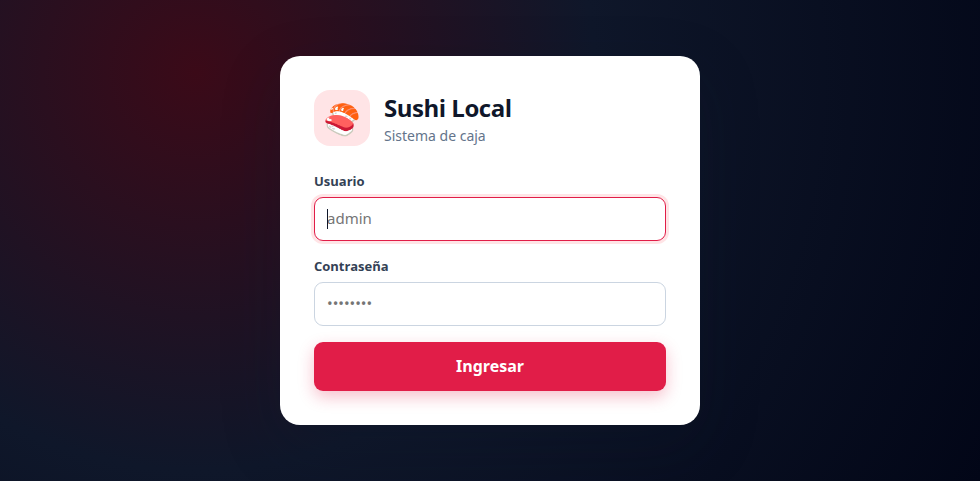
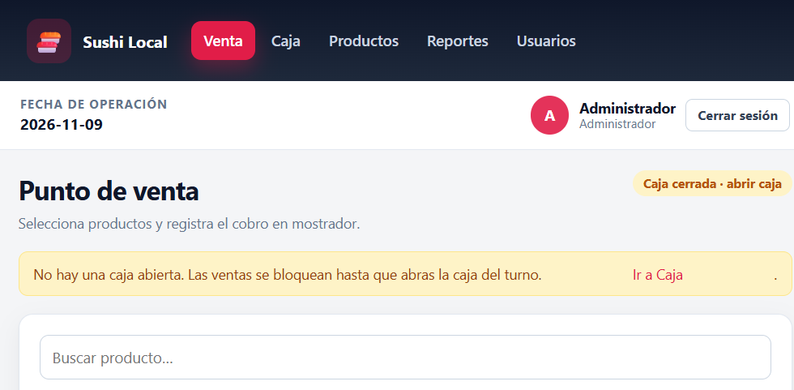
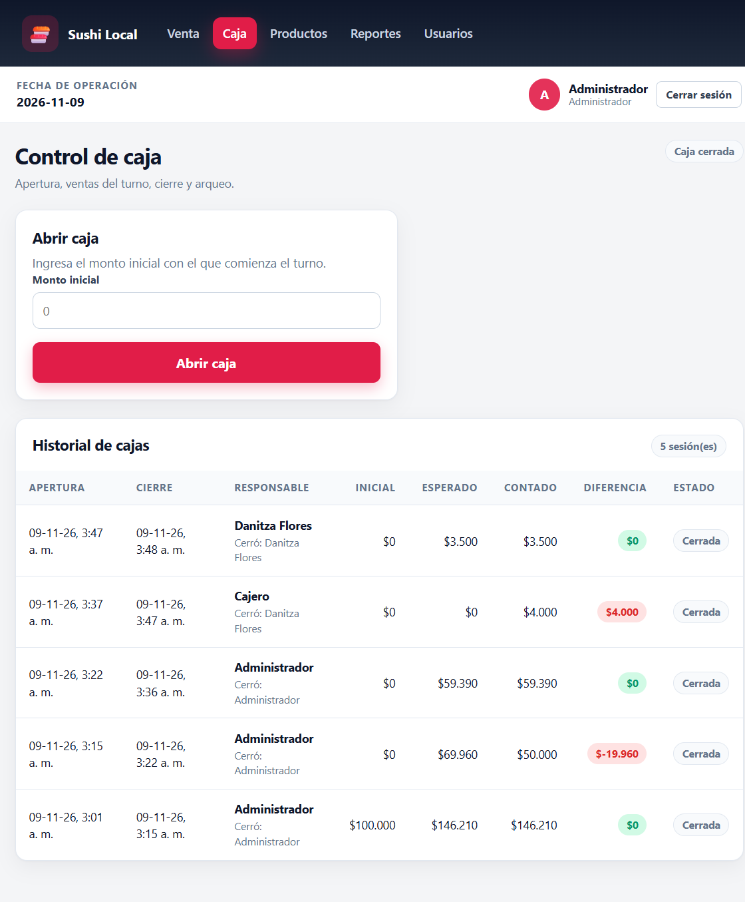
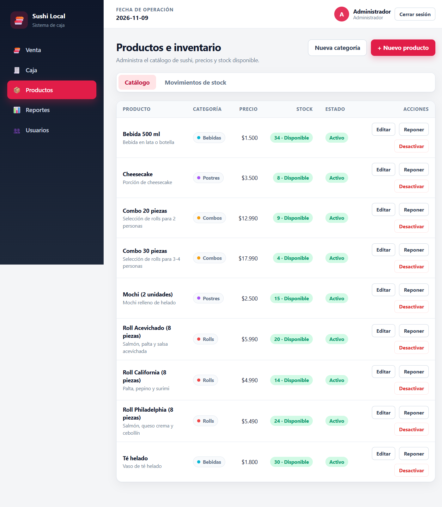
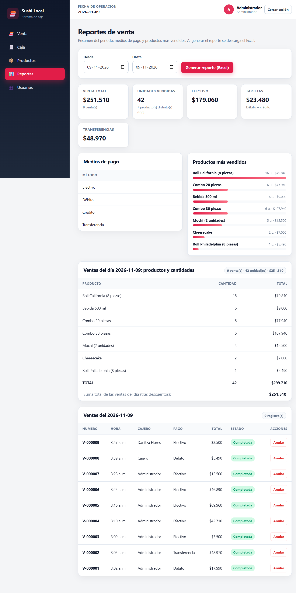
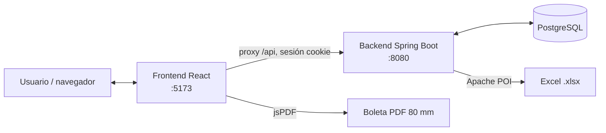

# Sushi Local — Sistema de caja (Punto de venta)

Sistema web de **punto de venta (POS) y control de caja para un local de sushi**,
pensado para atención en **mostrador / para llevar (sin mesas)**.

Permite vender en mostrador, controlar la caja del turno, mantener el
inventario actualizado en cada venta, administrar productos, categorías y
usuarios, y consultar reportes de venta del día con exportación a Excel.
Cada cobro genera una **boleta en PDF**.

> Carpeta del proyecto: `sistemasushi/` (el backend interno se llama `backend/`).
> La conexión a PostgreSQL se configura con variables de entorno (ver sección 5.1).

> 📄 **Requerimientos del sistema:** revisa [`REQUERIMIENTOS.md`](REQUERIMIENTOS.md)
> para conocer en detalle qué hace el sistema, sus reglas de negocio, roles,
> permisos y limitaciones.

---

## 1. ¿Qué es el sistema?

Es una aplicación web de dos partes:

| Parte | Carácter |
|---|---|
| **Frontend** (`frontend/`) | Interfaz del cajero/administrador: Venta, Caja, Productos, Reportes y Usuarios. Se sirve en `http://localhost:5173` (Vite) y se comunica con el backend vía proxy `/api`. |
| **Backend** (`backend/`) | API REST en `http://localhost:8080` (`/api/...`) con autenticación por sesión (cookie `JSESSIONID`), control de acceso por roles, reglas de negocio y generación del Excel. |
| **Base de datos** | PostgreSQL (base y credenciales configurables por variables de entorno). Hibernate crea/actualiza el esquema automáticamente (`ddl-auto=update`). |

### Flujo de uso (resumen)

1. **Iniciar sesión** con usuario y contraseña (roles `ADMIN` y `CASHIER`).
2. **Abrir caja** con el monto inicial del turno (**Caja**). Sin caja abierta
   las ventas están bloqueadas.
3. **Vender en mostrador** (**Venta**): se eligen productos, se indica el medio
   de pago (Efectivo, Débito, Crédito, Transferencia), descuento y monto recibido.
4. Al cobrar aparece la **Vista previa** con el detalle. El botón
   **🧾 Generar boleta** registra la venta y descarga la boleta en **PDF**;
   también se puede cobrar sin boleta.
5. El **stock se descuenta solo** con cada venta y se **restaura** al anular.
   Los movimientos quedan en el historial de inventario.
6. Al cerrar el turno se compara el **efectivo contado** con el **esperado**
   (monto inicial + ventas en efectivo) y se guarda la diferencia.
7. En **Reportes** se ven las ventas del día/período (producto, cantidad,
   total de unidades y suma total) y al pulsar **Generar reporte (Excel)** se
   descarga el archivo `.xlsx`.

---

## 2. Funcionalidades principales

### Venta en mostrador
- Catálogo filtrable por búsqueda y por categoría, con control de stock
  (no se puede vender más de lo disponible).
- Carrito con cantidades, precios, subtotal, descuento y vuelto (efectivo).
- Vista previa antes de cobrar y generación de **boleta PDF** (ticket 80 mm).
- Ventas identificadas con folio `V-000001`, `V-000002`, …

### Caja
- Apertura, cierre y arqueo con diferencia (esperado vs. contado).
- Historial de sesiones de caja (apertura, cierre, responsable, montos).

### Productos, categorías e inventario
- CRUD de productos y categorías (solo **ADMIN** puede escribir).
- Reposición de stock con motivo y registro de movimientos:
  `SALE`, `SALE_VOID`, `RESTOCK`, `ADJUSTMENT`.
- Desactivación lógica de productos.

### Reportes
- Resumen por período: venta total, unidades vendidas, efectivo, tarjetas,
  transferencias.
- Medios de pago y productos más vendidos.
- Tabla **“Ventas del día: productos y cantidades”** (producto, cantidad, total)
  con TOTAL en unidades y suma total de ventas.
- Listado de ventas del día con anulación (solo **ADMIN** anula).
- **Exportación a Excel** (`.xlsx`) al generar el reporte: hojas *Resumen*,
  *Productos* y *Ventas*.

### Usuarios y roles
- **ADMIN**: todo (usuarios, inventario, reportes, escritura de productos/categorías, anular ventas).
- **CASHIER**: vende, opera caja y ve reportes.
- Vista **Usuarios** solo para ADMIN (menú, ruta y API).
- Protección: no se puede desactivar ni degradar al último administrador activo.
- Mensajes mostrados con **SweetAlert2** (éxito, error y confirmación).

---

## 3. Herramientas / Stack tecnológico

### Backend — `backend/`
| Herramienta | Versión / uso |
|---|---|
| **Java** | **17** (JDK 17) |
| **Spring Boot** | **4.1.2** (`spring-boot-starter-parent`) |
| **Spring Framework** | 7.0.10 (incluido por Boot 4) |
| **Spring Web MVC** | `spring-boot-starter-webmvc` (Tomcat 11 embebido) |
| **Spring Data JPA + Hibernate** | ORM 7.4.13, `spring-boot-starter-data-jpa` |
| **PostgreSQL** | Driver JDBC 42.7.14 |
| **Spring Security** | Sesión por cookie `JSESSIONID`, BCrypt, CORS, roles `ADMIN`/`CASHIER` |
| **Bean Validation** | `spring-boot-starter-validation` (Hibernate Validator) |
| **Apache POI** | **5.3.0** (`poi-ooxml`) → generación del Excel `.xlsx` |
| **Lombok** | 1.18.48 (`@Getter`, `@Setter`, …) |
| **DevTools** | `spring-boot-devtools` (reinicio en desarrollo) |
| **Tests** | JUnit 5 + Spring Boot Test + H2 (perfil `test`, sin PostgreSQL) |
| **Maven** | Wrapper `mvnw` 3.9.13 |

Paquete base: `cl.ipfsoftware.backend`, clase principal
`BackendApplication`, artefacto Maven `backend` (`backend-1.0.0.jar`).
Puerto por defecto: **8080**.

Más detalle en [`backend/README.md`](./backend/README.md).

### Frontend — `frontend/`
| Herramienta | Versión / uso |
|---|---|
| **React** | **19.1.0** |
| **Vite** | **6.3.5** (dev server + proxy `/api` → `http://localhost:8080`) |
| **TypeScript** | **5.8.3** |
| **react-router-dom** | **7.6.2** (rutas `/`, `/caja`, `/productos`, `/reportes`, `/usuarios`) |
| **jsPDF** | **4.2.1** + `jspdf-autotable` → boleta PDF (ticket 80 mm) |
| **SweetAlert2** | **11.26.25** → mensajes de éxito/error/confirmación |
| **CSS** | CSS propio en `src/styles.css` (sin framework de UI) |

### Base de datos
- **PostgreSQL** (conexión configurable mediante `DB_URL`, `DB_USER` y
  `DB_PASSWORD`). Tablas creadas por Hibernate:
  `app_users`, `categories`, `products`, `sales`, `sale_items`,
  `cash_sessions`, `stock_movements`.

### Herramientas de desarrollo
- **IntelliJ IDEA 2026.1.3** con JDK **17** registrado como `"17"`.
- **Git** + GitHub (repositorio remoto).
- **Node.js + npm** para el frontend (`npm install`, `npm run dev`, `npm run build`).

---

## 4. Requisitos

- JDK **17** (la clase se compila con `release 17`).
- **PostgreSQL** con una base de datos creada y sus credenciales de acceso (ver abajo).
- **Node.js** (LTS) y **npm**.

---

## 5. Instalación y ejecución

### 5.1 Configurar la base de datos

Crea una base de datos PostgreSQL (con el nombre que elijas) y define la
conexión mediante variables de entorno. **No hay credenciales en el
repositorio.**

```sql
CREATE DATABASE <nombre_de_la_base>
WITH ENCODING 'UTF8' TEMPLATE template0;
```

```bash
export DB_URL='jdbc:postgresql://localhost:5432/<nombre_de_la_base>'
export DB_USER='<usuario>'
export DB_PASSWORD='<contraseña>'
```

Para Docker Compose puedes crear un archivo `.env` en la raíz del proyecto
(no se versiona; usa `.env.example` como plantilla).

| Variable | Descripción |
|---|---|
| `DB_URL` | URL JDBC completa de PostgreSQL. |
| `DB_USER` | Usuario de la base de datos. |
| `DB_PASSWORD` | Contraseña de la base de datos. |

### 5.2 Backend

Desde `backend/`:

```powershell
.\mvnw.cmd -B clean test     # compila y pasa los tests (H2, sin PostgreSQL)
.\mvnw.cmd spring-boot:run   # arranca en http://localhost:8080
```

O en IntelliJ IDEA: abrir el proyecto `backend/`, **Reload All Maven
Projects** y ejecutar la configuración **BackendApplication** (módulo `backend`,
JDK `17`).

### 5.3 Frontend

Desde `frontend/`:

```powershell
cmd /c "npm install"
cmd /c "npm run dev"        # http://localhost:5173 (proxy /api -> 8080)
cmd /c "npm run build"      # build de producción en frontend/dist
cmd /c "npm run preview"    # sirve el build de producción
```

### 5.4 Usuarios iniciales (se crean en el primer arranque)

Si la tabla de usuarios está vacía, `DataSeeder` crea las cuentas iniciales
usando las variables de entorno `SEED_ADMIN_USERNAME`, `SEED_ADMIN_PASSWORD`,
`SEED_CASHIER_USERNAME` y `SEED_CASHIER_PASSWORD` (las dos últimas son
opcionales). No hay usuarios ni contraseñas por defecto en el código.

```bash
export SEED_ADMIN_USERNAME='admin'
export SEED_ADMIN_PASSWORD='<contraseña-segura>'
export SEED_CASHIER_USERNAME='cajero'
export SEED_CASHIER_PASSWORD='<contraseña-segura>'
```

El login **no distingue mayúsculas** (`Admin` entra como `admin`).
**Cambia estas contraseñas** desde **Usuarios** antes de usar el sistema en el local.

---

## 6. Capturas del sistema funcionando

Capturas reales tomadas en local (`frontend` 5173 → `backend` 8080 → PostgreSQL),
con una sesión de administrador iniciada. Fecha de operación: **2026-11-09**.

### 6.1 Inicio de sesión



### 6.2 Punto de venta (Venta)



> Sin caja abierta el sistema indica que debe abrirse la caja del turno
> (las ventas están bloqueadas). En el header se ve el usuario
> **Administrador / Administrador** y el botón **Cerrar sesión**.

### 6.3 Control de caja



### 6.4 Productos e inventario



### 6.5 Reportes de venta (con datos del día)



En esta captura el reporte del día muestra: **venta total \$251.510**,
**42 unidades vendidas**, **9 ventas**, totales por efectivo/tarjetas/
transferencias, productos más vendidos y tablas de ventas del día.
Al pulsar **Generar reporte (Excel)** se descarga el `.xlsx`.

---

## 7. Estructura del proyecto

```text
sistemasushi/
├─ backend/                 # API Spring Boot (paquete cl.ipfsoftware.backend)
│  ├─ src/main/java/.../   controllers, servicios, repositorios, DTOs, dominio
│  ├─ src/main/resources/  application.properties (PostgreSQL, CORS, sesión)
│  ├─ src/test/            tests con H2 (perfil test)
│  ├─ pom.xml / mvnw        Maven 3.9.13, Java 17
│  └─ README.md             ← documentación técnica del backend
├─ frontend/                # React + Vite + TypeScript
│  ├─ src/pages/           Login, Pos (Venta), Cash (Caja), Products, Reports, Users
│  ├─ src/components/      Layout (sidebar + header), Modal, MoneyInput
│  ├─ src/pdf/             generación de la boleta en PDF (jsPDF)
│  ├─ src/api.ts           cliente HTTP (fetch, credenciales incluidas)
│  └─ package.json         React 19, Vite 6, sweetalert2, jspdf
├─ docs/screenshots/      capturas del sistema funcionando (esta carpeta)
└─ README.md              ← este archivo (especificaciones del proyecto)
```

### Arquitectura (resumen)



---

## 8. Notas

- El sistema es de **mostrador** (sin mesas): no hay gestión de mesas ni de comandas por mesa.
- La zona horaria de negocio es **America/Santiago** (`spring.jackson.time-zone`,
  `hibernate.jdbc.time_zone` y `SaleService.BUSINESS_ZONE`).
- Los montos se guardan y muestran en **CLP** (sin decimales en la UI).
- Medios de pago: Efectivo (`CASH`), Débito (`DEBIT`), Crédito (`CREDIT`),
  Transferencia (`TRANSFER`).

---

## 9. Despliegue con Docker (servidor)

El proyecto incluye `Dockerfile` y `docker-compose.yml` para desplegar en un
servidor con un solo contenedor: la aplicación (Spring Boot sirviendo también
el frontend compilado). Acceso por `http://<ip-del-servidor>:8000`.

La conexión a PostgreSQL se define con `DB_URL`, `DB_USER` y `DB_PASSWORD`
en un archivo `.env` en la raíz del proyecto (ver `.env.example`). Ese archivo
no se versiona.

### 9.1 Requisitos en el servidor

- Docker Engine y Docker Compose v2 (`docker compose`).

### 9.2 Pasos

```bash
git clone <url-del-repositorio>
cd sistemasushi
cp .env.example .env   # completa DB_URL, DB_USER y DB_PASSWORD
docker compose up -d --build
docker compose logs -f app
```

La primera vez Hibernate crea el esquema (`ddl-auto=update`) y el `DataSeeder`
crea los usuarios iniciales definidos en las variables `SEED_*` y los
productos de ejemplo.

### 9.3 Comandos útiles

| Comando | Descripción |
|---|---|
| `docker compose ps` | Estado del contenedor. |
| `docker compose logs -f app` | Logs de la aplicación. |
| `docker compose down` | Detiene el contenedor. |
| `docker compose up -d --build` | Reconstruye y reinicia tras cambiar el código. |
| `./deploy.sh` | Actualiza con `git pull`, reconstruye y verifica la app. |

### 9.4 Actualizar el despliegue

Desde el servidor, para bajar los últimos cambios y redesplegar:

```bash
cd ~/sistemasushi
./deploy.sh
```

El script hace `git pull --ff-only`, reconstruye la imagen, reinicia el
contenedor y verifica que la aplicación responda. Si solo quieres reconstruir
sin tocar Git, usa `./deploy.sh --no-pull`.

> La base de datos PostgreSQL es externa al contenedor de la aplicación.
> Para administrarla usa `psql` o un cliente externo.

> Cambia las contraseñas iniciales desde **Usuarios** antes de operar.
